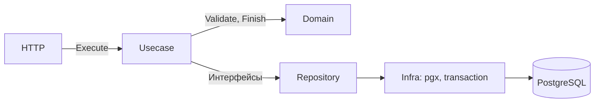

# TripGo — лабораторные работы 1 и 2

 - Сервис создаёт, хранит и завершает поездки
 - Данные находятся в PostgreSQL
 - Реализованы ЛР1 с обоими бонусами и основная часть ЛР2

## Запускаем сервис

Нужны:
 1. Go 1.27.1, make, работающий Docker, `tripgoctl` и golangci-lint 2.14.0
 2. Для проверки ручек нужен curl, для запуска сервиса в Docker — Python 3
 3. Все команды выполняем из корня репозитория

### Скачиваем Go-зависимости

```bash
go version # Ожидаем Go 1.27.1
go mod download
```

### Поднимаем окружение и сервис

При первом запуске создаём кластер:

```bash
tripgoctl cluster start
```

Поднимаем PostgreSQL и стек телеметрии, применяем миграции и запускаем сервис:

```bash
tripgoctl environment start && make migrate && make run
```

Makefile сам читает `.env.example` и `.env`, созданный `tripgoctl`.
Адрес БД можно посмотреть через `tripgoctl connect`.

## Проверяем ручки

Примеры используют порт 8080;

### Проверяем сервис

```bash
curl -i localhost:8080/health
curl -i localhost:8080/ready
```

Обе ручки должны вернуть `200` и `{"status":"ok"}`.

### Создаём поездку

```bash
curl -i -X POST localhost:8080/api/v1/trips \
  -H 'Content-Type: application/json' \
  -d '{"user_id":"5cb72c04-7650-45c9-a79b-bcdba0631e0c",
       "driver_id":"8860b315-ec86-42eb-a17c-7c163d721ff5",
       "start_point":{"latitude":59.9398,"longitude":30.3146},
       "end_point":{"latitude":59.9290,"longitude":30.3626},
       "price":1450}'
```

Ожидается `201`, поездка в статусе `active` и заголовок `Location`.
Цена — в целых рублях. Повторяем эту команду: пока поездка активна,
ожидается `409 driver_busy`.

Копируем `id` из успешного ответа:

```bash
TRIP_ID='<id созданной поездки>'
```

### Получаем поездку

```bash
curl -i localhost:8080/api/v1/trips/$TRIP_ID
```

Ожидается `200` и созданная поездка.

### Завершаем поездку

```bash
curl -i -X POST localhost:8080/api/v1/trips/$TRIP_ID/finish
```

Ожидается `200`, статус `completed` и время `finished_at`.
Повторяем команду: ожидается `409 trip_completed`, время завершения не меняется.

### Проверяем ошибки

```bash
# Некорректный UUID — 400 invalid_request
curl -i localhost:8080/api/v1/trips/not-a-uuid

# Нет обязательных полей — 400 invalid_request
curl -i -X POST localhost:8080/api/v1/trips \
  -H 'Content-Type: application/json' -d '{}'
```

Для корректного UUID отсутствующей поездки возвращается `404 trip_not_found`.
Ошибки поездок имеют формат `application/problem+json` с полем `code`.

### Проверяем доступность БД

Не останавливая сервис, выполняем:

```bash
tripgoctl environment stop
curl -i localhost:8080/health
curl -i localhost:8080/ready
```

`/health` должен остаться `200`, а `/ready` — вернуть `503`.
Восстанавливаем PostgreSQL:

```bash
tripgoctl environment start
curl -i localhost:8080/ready
```

Теперь `/ready` снова должен вернуть `200`.

## Idempotency-Key

После завершения поездки из примера создаём новую с ключом:

```bash
curl -i -X POST localhost:8080/api/v1/trips \
  -H 'Content-Type: application/json' \
  -H 'Idempotency-Key: 7f1c2a54-6d0e-4a3b-9f21-0c8e5b3a77d1' \
  -d '{"user_id":"5cb72c04-7650-45c9-a79b-bcdba0631e0c",
       "driver_id":"8860b315-ec86-42eb-a17c-7c163d721ff5",
       "start_point":{"latitude":59.9398,"longitude":30.3146},
       "end_point":{"latitude":59.9290,"longitude":30.3626},
       "price":1450}'
```

Первый запрос с новым ключом вернёт `201`. Повторяем команду без изменений —
получаем `200` и тот же id. Меняем цену, сохранив ключ, — получаем
`409 idempotency_conflict`. Для новой операции используем новый UUID ключа.
Без заголовка выполняется обычное создание

Ключ действует **24 часа** (`IDEMPOTENCY_TTL=24h`). Повторы срок не продлевают.
После истечения ключ можно использовать заново. Просроченные записи очищаются
при запросах с ключом. Повтор с ключом возвращает актуальное состояние поездки, в том числе после завершения. Его также получаем через `GET`. Для идемпотентности - таблица ключей, храним данные запроса и `trip_id`, её создаёт миграция `00003_create_trip_idempotency.sql`

Ключ, поездка и история сохраняются в одной транзакции. Блокировка записи ключа
защищает от одновременных повторов. При ошибке изменения откатываются

## Запуск в Docker

Сначала поднимаем окружение через `tripgoctl`, как описано выше.
Если сервис уже запущен через `make run`, останавливаем его, чтобы освободить порт.

```bash
make docker-build
make migrate && make docker-run
```

Проверяем `/health` и `/ready` теми же командами curl. Остановка — Ctrl+C.

[Dockerfile](Dockerfile) собирает приложение в образе с Go, затем копирует
бинарник в пустой `scratch`. В итоговом образе нет исходников и инструментов
сборки. Приложение работает без root, от пользователя `65532:65532`.
Размер образа после сборки:

```bash
docker image inspect trip-service:lab02 --format '{{.Size}} bytes'
```

[run-container.py](deploy/run-container.py) подключает контейнер к PostgreSQL
из `tripgoctl`: заменяет localhost в адресе БД на адрес внутри Docker-сети.
Файл `.env` не изменяется

## Настройки

Основные переменные обязательны; `SERVICE_VERSION` и `OTEL_TRACES_SAMPLER_ARG` имеют значения по умолчанию. Примеры находятся в [.env.example](.env.example),
реальный `DATABASE_URL` берётся из `.env`, созданного `tripgoctl`.

Конфиг читает `cleanenv`, ограничения проверяет `validator` по тегам структуры
`Config`.

| Переменная | Пример | Назначение |
|---|---|---|
| HTTP_ADDR | :8080 | Адрес сервера |
| LOG_LEVEL | info | Уровень логов |
| SHUTDOWN_TIMEOUT | 10s | Время на остановку сервиса |
| HTTP_READ_TIMEOUT | 5s | Чтение запроса |
| HTTP_READ_HEADER_TIMEOUT | 2s | Чтение заголовков |
| HTTP_WRITE_TIMEOUT | 10s | Запись ответа |
| HTTP_IDLE_TIMEOUT | 60s | Ожидание следующего запроса |
| DATABASE_URL | Из .env | Подключение к PostgreSQL |
| DATABASE_MAX_CONNS | 10 | Максимум соединений |
| DATABASE_MIN_CONNS | 2 | Минимум соединений |
| DATABASE_MAX_CONN_LIFETIME | 30m | Время жизни соединения |
| DATABASE_CONNECT_TIMEOUT | 5s | Таймаут подключения |
| DATABASE_QUERY_TIMEOUT | 3s | Таймаут запроса и транзакции |
| IDEMPOTENCY_TTL | 24h | Срок действия ключа |

## Основные решения

- HTTP-сервер — `net/http` и `chi`. Типы API генерируются из OpenAPI
- Работа с БД — `pgxpool`, SQL строится через `squirrel` с параметрами
- Менеджер `Do(ctx, fn)` передаёт транзакцию через контекст. При успехе делает
  commit, при ошибке или панике — rollback. Вложенный `Do` использует ту же транзакцию
- Уровень изоляции — **Read Committed**: бизнес-правила защищены индексом
  и блокировкой строки, поэтому более строгий уровень здесь не нужен
- Уникальный индекс запрещает две активные поездки одному водителю
- Завершение читает поездку через `SELECT FOR UPDATE`. Второй запрос ждёт
  первый и затем видит завершённый статус
- Поездка и история статусов меняются атомарно: ошибка истории откатывает операцию
- По SIGINT/SIGTERM сервер ждёт активные запросы и закрывает пул БД.
  Если `SHUTDOWN_TIMEOUT` истёк, завершение принудительное

## Команды и проверки

| Команда | Что делает |
|---|---|
| `make generate` | Генерирует OpenAPI и gomock-моки |
| `make build` | Собирает `bin/trip-service` |
| `make test` | Все тесты, включая интеграционные с PostgreSQL, с `-race -count=2`, покрытие пакетов и итог |
| `make test-unit` | Только unit-тесты без PostgreSQL, с `-race -count=2` и покрытием |
| `make test-integration` | Реальный PostgreSQL, `-race -count=2`, build tag `integration` |
| `make lint` | Все обязательные линтеры, форматтеры и правила слоёв |
| `make vet` | Проверяет код через `go vet` |
| `make migrate` | Применяет миграции |
| `make migrate-status` | Показывает состояние миграций |
| `make migrate-down` | Откатывает последнюю миграцию с удалением её таблицы и данных |

Команды миграций тоже получают настройки из Makefile — отдельная загрузка env не нужна.

## Останавливаем сервис

Останавливаем сервис через Ctrl+C в терминале запуска. PostgreSQL останавливаем с сохранением данных:

```bash
tripgoctl environment stop
```

## Архитектура

### Схема слоёв



Стрелки показывают вызовы. Интерфейсы объявлены у потребителя в `contract.go`:
репозиториев — в usecase, usecase — в HTTP-пакетах. Это позволяет подменять
зависимости моками. HTTP не импортирует репозитории и infra, домен не зависит
от транспорта и БД; ограничения закреплены в depguard

`cmd/service/main.go` читает конфиг и запускает приложение. `internal/container`
вручную создаёт зависимости и управляет остановкой HTTP, телеметрии и пула БД

### Принятые решения ЛР2

- Пакет на действие (`create`, `get`, `finish`) — у каждого сценария свои контракты и тесты
- Правила и переходы статусов — в домене; единый перевод ошибок в Problem — в `http/domainerror`
- `model` содержит алиасы доменных типов, чтобы не дублировать модель
- OpenAPI-код оставлен в корневом `api/`, как в ЛР1: сохраняются пути импортов и генерация. Это отступление от примера `internal/generated` не меняет правил зависимостей

API и миграции в ЛР2 не менялись

## Тесты ЛР2

Моки gomock генерируются через `go:generate` (`make generate`).
Интеграционные тесты с тегом `integration` работают с PostgreSQL из `tripgoctl`:
каждый создаёт и удаляет свою схему. Нужны права `CREATE` на БД.
Адрес — `TEST_DATABASE_URL` или `DATABASE_URL`; перед тестами проверяется соединение.

`make test` запускает все тесты, `make test-unit` — только unit,
`make test-integration` — только интеграционные. Проверки идут с `-race -count=2`.
Покрытие домена и usecase — 100%; отчёт покрытия сохраняется в `coverage.out`.

## Телеметрия

Настройки находятся в [.env.example](.env.example):

| Переменная | Назначение |
|---|---|
| `OTEL_SERVICE_NAME` | Имя сервиса |
| `OTEL_EXPORTER_OTLP_ENDPOINT` | Адрес коллектора из `tripgoctl` |
| `OTEL_EXPORTER_OTLP_PROTOCOL` | `http/protobuf` или `grpc` |
| `OTEL_RESOURCE_ATTRIBUTES` | Namespace и окружение |
| `OTEL_TRACES_SAMPLER`, `OTEL_TRACES_SAMPLER_ARG` | Сэмплирование трейсов |
| `SERVICE_VERSION` | Версия сборки, по умолчанию `dev` |

Middleware: **Recover → Tracing → Logging → Metrics**. Логи — JSON в stdout,
с `trace_id` и `span_id`; HTTP- и SQL-спаны связаны через контекст.
В `http.route` хранится шаблон без UUID. Recover буферизует ответ, чтобы при
панике вернуть цельный Problem 500. Метрики и трейсы уходят по OTLP;
недоступность коллектора не останавливает сервис.

### Проверка телеметрии

Создали поездку, затем выполнили серию запросов её получения.
Трейс в Jaeger нашли по `trace_id` из лога: `e651d0c9daf2647cfdd569489bdf03b6`.

| Скриншот | Что сделали | Что видим |
|---|---|---|
| [Jaeger](assets/jaeger.png) | Создали поездку через `POST /api/v1/trips` | HTTP-спан со статусом `201` и вложенные `BEGIN`, два `INSERT`, `COMMIT`. Запрос занял 16,4 мс; у выбранного INSERT видны `db.collection.name=trips` и `db.operation.name=INSERT`. |
| [Созданные поездки](assets/grafana-created.png) | Проверили `tripgo_trips_created_total` в Grafana | Счётчик равен 1: создана одна поездка. |
| [Длительность запросов](assets/grafana-duration.png) | Выполнили серию GET-запросов и рассчитали p95 по гистограмме за последние 5 минут | На графике p95 около 9–9,6 мс; в легенде — шаблон `/api/v1/trips/{tripId}` без UUID. |

`NaN` для POST-маршрута на графике p95 допустим, если в выбранном пятиминутном окне не было POST-запросов.
